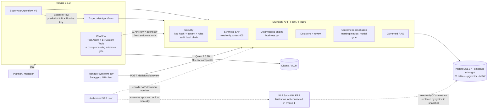
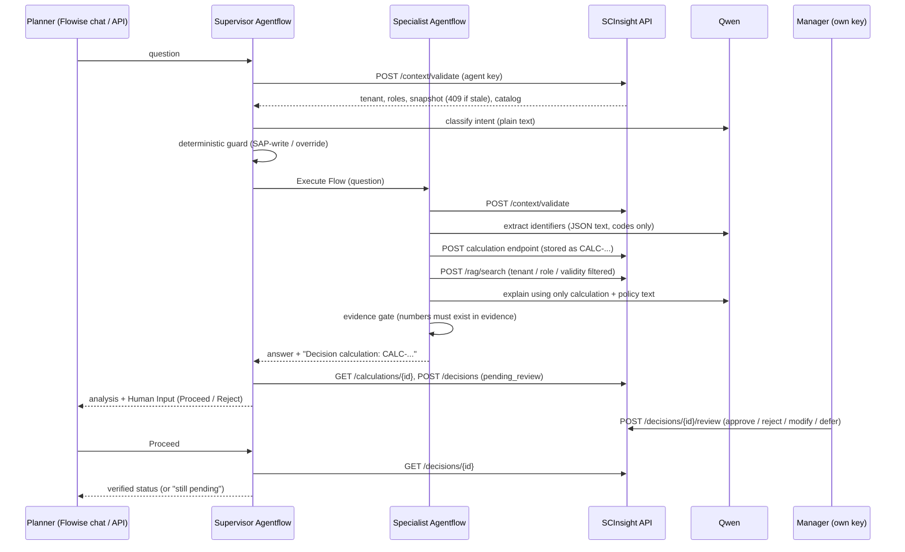

# Architecture

**SAP ERP in the workflow.** SCInsight never talks to SAP at request time. A target deployment would extract read-only data from
the SAP S/4HANA OData APIs (`API_MATERIAL_STOCK_SRV`, `API_BATCH_SRV`, `API_BILL_OF_MATERIAL_SRV`, `API_PRODUCTION_ORDER_2_SRV`,
`API_PURCHASEORDER_PROCESS_SRV`, `API_SALES_ORDER_SRV`, `API_INSPECTIONLOT_SRV`) into the snapshot tables. In Phase 1 the synthetic
snapshot `SAP-SYN-2026-10-21T0600Z` stands in for that extract. Approved actions are executed in SAP by a human, and the SAP goods
receipt later verifies the outcome.

## Request path (supervisor)

## Design decisions

- **Calculations are code; the LLM explains.** Identifier extraction maps names to codes from the catalog returned by
  `/context/validate`. The calculation is done by the API. The explanation model sees only the deterministic summary
  and the policy excerpts. The evidence gate is the final check.
- **CustomFunction nodes call the API, not HTTP nodes.** In Flowise 3.1.2 the HTTP node throws on any non-2xx response, which
  aborts the run. Custom Functions turn a 409 (stale snapshot), 404 or 422 into a governed message and write flat string
  state. `{{ output.x }}` keeps the literal template when a value is missing, so every key is always returned.
- **No structured-output parser for extraction or classification.** With Qwen 7B, Flowise's zod parser aborted the run
  when the model left out a key or wrote `NONE` without quotes. The model now returns JSON or plain text, and code parses it
  leniently.
- **Branch merge.** The six decision specialists converge on one "save recommendation" node. Flowise counts inputs that come
  from branches of the same Condition as one conditional group, so one arriving input is enough. The learning specialist never
  creates recommendations.
- **Flows are protected by a Flowise API key** (`apikeyid`). Execute Flow authenticates with the `chatflowApi` credential and
  calls `http://flowise:3000`. Loopback is denied by the SSRF policy, so the request URL cannot be used.

## Data stores

| Store | Content |
|---|---|
| `tenants`, `users`, `role_assignments` | Two synthetic tenants, 10 users; API keys stored as SHA-256 only |
| `sap_snapshots` … `transport_lanes` | Synthetic SAP extract (snapshot `SAP-SYN-2026-10-21T0600Z`, as of 2026-10-21) |
| `agent_runs` | Every calculation: request, result, provenance (snapshot id, synthetic flag) |
| `recommendations`, `human_decisions`, `sap_execution_refs` | Review lifecycle; SAP execution is recorded by a separate role, never performed |
| `observed_outcomes`, `learning_records`, `model_versions`, `retraining_requests` | Verified outcomes, training labels, candidate / promoted models |
| `audit_events` | SHA-256 hash chain (`prev_hash`, `hash`), written under an advisory lock |
| `rag_documents`, `rag_chunks` | Governed knowledge; `embedding_vec vector(384)` with an HNSW cosine index (PostgreSQL) |
