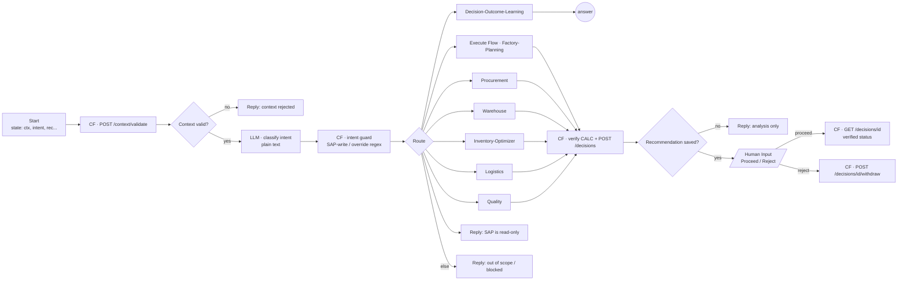
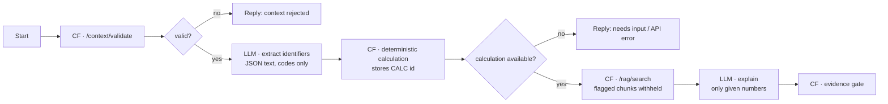
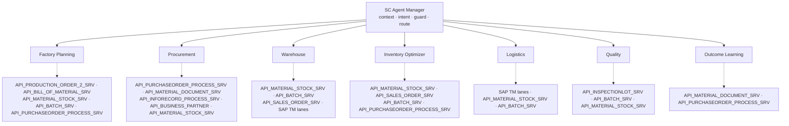

# Agentflows V2

All 8 Agentflows are generated by `flowise/scinsight/build-scinsight.cjs` from the node classes of the installed Flowise 3.1.2.
Inputs, anchors and versions are therefore exactly what the Flowise UI saves. Exports: `flowise/agentflows/`.

## Supervisor: SCInsight-Cosmetics-Supervisor-Agentflow-v1 (24 nodes, 26 edges)

| Step | Node | Notes |
|---|---|---|
| Context | Custom Function → `POST /api/v1/context/validate` | Tenant, user, roles and snapshot freshness come from the API key. Returns the identifier catalog. 401/403/409 end the run with the API's message. |
| Intent | LLM (no memory, plain-text answer) | 9 intents: factory_planning, procurement, warehouse, inventory_optimizer, logistics, quality, outcome_learning, sap_write_request, out_of_scope |
| Guard | Custom Function | Reads the classifier text and overrides it: SAP-write wording becomes `sap_write_request`, override attempts become `out_of_scope`, and an unknown intent becomes `out_of_scope` |
| Route | Condition (`{{ $flow.state.intent }}` equal …) | 8 conditions + else |
| Specialists | Execute Flow | `executeFlowBaseURL = __FLOWISE_INTERNAL_URL__`, credential `chatflowApi`; the output goes to `specialist_output` |
| Save | Custom Function | Reads `Decision calculation: CALC-…` from the specialist answer. Checks the stored calculation (`GET /calculations/{id}`) and that it proposes actions, then `POST /decisions` with idempotency key `flowise:<chatId>:<CALC>` |
| Human Input | Fixed description | Flowise prepends the specialist answer. The text says the approval is recorded only in the API by the named roles. |
| Proceed | Custom Function → `GET /decisions/{id}` | Reports the verified review, or "still pending_review … Clicking Proceed in Flowise is not an approval" |
| Reject | Custom Function → `POST /decisions/{id}/withdraw` | The requester withdraws; it stays in the audit trail |

## Specialists (10–12 nodes each)

| Specialist | Calculation endpoints | Recommendation reviewed by |
|---|---|---|
| Factory-Planning | `POST /optimizer/material-readiness`. Production order given alone, or resolved from the SKU via `GET /sap/production-orders` | production_planner |
| Procurement | `POST /optimizer/replenishment` (material + quantity + need date) and `POST /forecast/lead-time` per supplier of the material | procurement_manager |
| Warehouse | `POST /optimizer/warehouse-balancing` | warehouse_manager |
| Inventory-Optimizer | `POST /optimizer/replenishment` (+ `POST /forecast/demand` for warehouse locations) | warehouse_manager (procurement_manager for material purchases) |
| Logistics | `POST /optimizer/warehouse-balancing` (lane, mode, lead time, freight cost) | warehouse_manager |
| Quality | `POST /quality/check-stock` | quality_manager |
| Decision-Outcome-Learning | `GET /decisions/{id}`, `POST /outcomes/reconcile` (executed only), `GET /learning/metrics` | no recommendation |

The supply-chain director may review every domain.

## SAP S/4HANA ERP APIs behind each specialist (illustration)

In Phase 1 every specialist reads the synthetic snapshot through the SCInsight API. In a real deployment, the same data would
come from these SAP S/4HANA OData APIs via a read-only extract. The supervisor canvas shows them in a panel under each specialist.

All of these are reads. The transport lanes are a synthetic table in Phase 1; SAP TM would supply them in production. Nothing
is ever written to SAP.

**Evidence gate.** It extracts every number from the explanation and compares it with the numbers in the calculation JSON,
the deterministic summary, the policy excerpts and the question. If any number is unsupported, the narrative is withheld and
the deterministic summary is returned. The footer is always added:
`Decision calculation: CALC-… · SAP snapshot: …`, the policy citations, and the line saying who must approve.

## Flowise behaviours this design depends on (verified in 3.1.2)

- With memory off, `llmUserMessage` is ignored, so the user content is an explicit `user` message in `llmMessages`.
- `{{ output.key }}` in Update State reads JSON paths. A missing or null value keeps the literal template, so Custom Functions
  return every key as a string.
- In fixed mode, Human Input prepends the last chat message to the description.
- A non-2xx response in the HTTP node throws, so the API is called from Custom Functions (`require('node-fetch')`, the SSRF-guarded wrapper).
