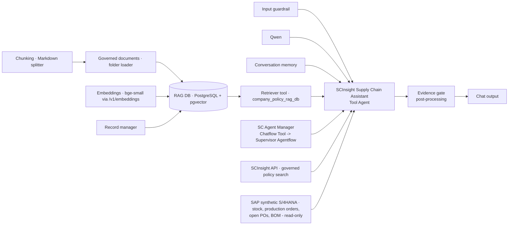

# Chatflow: SCInsight-Cosmetics-Chatflow-v1 (the chat front door)

Export: `flowise/chatflows/SCInsight-Cosmetics-Chatflow-v1.json` (16 functional nodes, 15 edges, plus note panels), with
`SCInsight-Cosmetics-Chatflow-v1.chatbotConfig.json` (post-processing) and `.postprocessing.js` (the same code, readable).

The canvas uses the same design as the Aurelia copilot Chatflow (`flowise/build-flows.cjs`): the RAG pipeline on the left feeding
the RAG DB and a retriever tool, the input guardrail, the model and memory, a column of tools, and the Tool Agent on the right.
Every tool calls the SCInsight app itself. All orchestration (routing, the 7 specialists, calculations, approval) lives only in the
**SC Agent Manager Agentflow** (`SCInsight-Cosmetics-Supervisor-Agentflow-v1`); the chatflow never repeats calculations.

| Node (Flowise component) | What it does |
|---|---|
| Chunking · `markdownTextSplitter` (800 / 100) | Splits the governed documents on markdown structure |
| Governed documents · `folderFiles` (`opt/flows/scinsight/knowledge`) | The Belleva policies, SOPs, specs and supplier agreements the agent key may read (copied by `deploy.py build`) |
| Embeddings · `openAIEmbeddingsCustom` | BAAI/bge-small-en-v1.5 through the FastAPI gateway `/v1/embeddings` (the model the SCInsight API RAG uses) |
| Record manager · `postgresRecordManager` | Re-indexing never duplicates (full cleanup) |
| RAG DB · `postgres` vector store | PostgreSQL database `scinsight`, table `scinsight_flowise_rag`, cosine, top 4 |
| Retriever tool · `company_policy_rag_db` | Company rules, thresholds, approval policies, contract clauses, with source files |
| Input guardrail · `inputModerationSimple` | Blocks instruction overrides, SAP-change phrases, requests for keys |
| Qwen · `chatOpenAICustom` (temperature 0) | The assistant's model; it never calculates numbers |
| Conversation memory · `bufferWindowMemory` (k = 6) | Conversation context |
| SC Agent Manager · `ChatflowTool` → Supervisor Agentflow | Every planning or analysis question, and the status or outcome of a REC-… |
| SCInsight API · governed policy search · `customTool` `search_supply_chain_policy` | Same documents through POST /api/v1/rag/search (tenant-, role- and validity-filtered, `[doc_id section]` citations) |
| SAP S/4HANA (synthetic) · `get_sap_inventory`, `get_production_orders`, `get_open_purchase_orders`, `get_material_bom` | Raw read-only SAP records from the SCInsight API (`/api/v1/sap/*`); never used to calculate |
| SCInsight Supply Chain Assistant · `toolAgent` (max 4 iterations) | Picks one tool and relays its answer without changing numbers |
| Evidence gate · `chatbotConfig.postProcessing` | Every number must come from a tool result, otherwise the tool result is shown instead. Appends tools, CALC ids and policy documents |

## Approval from the chat

When an action is proposed, the SC Agent Manager saves the recommendation and pauses at its Human Input step. The chat shows
the analysis and the `REC-…` id. The responsible manager approves it in the SCInsight API with their own key; ask the chat
"status of REC-…" to read the verified decision. The Proceed / Reject buttons appear only when chatting with the Supervisor
Agentflow directly. Each chat call starts a new supervisor session (`startNewSession`), so no paused state is shared between conversations.

## Tools kept outside the chatflow

The calculation tools (`check_material_readiness`, `calculate_stock_cover`, `optimize_warehouse_transfer`, `check_batch_quality`,
`forecast_demand`, `get_supplier_reliability`, `save_recommendation`, `get_decision_status`, `get_verified_outcomes`) are imported in
Flowise → Tools but not wired into the chatflow: the specialists do this work inside the Agentflow.

## RAG: two paths over the same governed documents

1. **Company RAG DB (native Flowise)**: this chatflow's pipeline (table `scinsight_flowise_rag`) and the Document Store
   "SCInsight policy RAG DB" (table `scinsight_flowise_rag_docstore`) read by the Retriever node of every specialist Agentflow.
   Indexed by `flowise/scinsight/deploy.py import`. Only documents of tenant `scinsight-cosmetics` that the agent key may read are copied
   to `flowise/scinsight/knowledge/` (the Northwind document and the malformed test document are excluded), because a native store has
   no tenant or role filter.
2. **Governed API RAG**: POST /api/v1/rag/search. Validates front matter, chunks by `##` section (900 / 120), embeds with bge-small,
   stores `rag_chunks.embedding_vec` (HNSW), filters by tenant, role and validity, and withholds chunks with instruction-like text.
   The specialists' "Policy search (RAG)" step and the `search_supply_chain_policy` tool use it; its `[doc_id section]` citations feed the evidence footer.

Flowise 3.x rejects absolute folder-loader paths (`PATH_TRAVERSAL_SAFETY`), so the loader path is relative (`opt/flows/...`); the
Flowise process runs in `/`.
