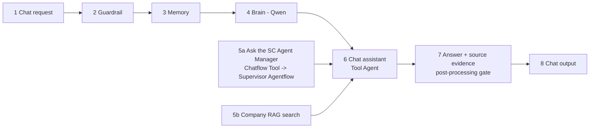

# Chatflow: SCInsight-Cosmetics-Chatflow-v1 (the chat front door)

Export: `flowise/chatflows/SCInsight-Cosmetics-Chatflow-v1.json` (6 functional nodes, 5 edges, plus note panels), with
`SCInsight-Cosmetics-Chatflow-v1.chatbotConfig.json` (post-processing) and `.postprocessing.js` (the same code, readable).

The chatflow is deliberately small. It holds the conversation and company RAG. All orchestration lives only in the
**SC Agent Manager Agentflow** (`SCInsight-Cosmetics-Supervisor-Agentflow-v1`): routing, the 7 specialists, SAP data,
calculations and approval. The chatflow never repeats SAP queries or calculations.

The canvas reads left to right in these numbered steps. Under every node there is a panel saying what it does, its input and its output.

| Step | Node (Flowise component) | What it does |
|---|---|---|
| 1 Chat request | note | Flowise chat bubble, embedded widget or prediction API. Flowise chatflows have no chat-input node. |
| 2 Guardrail | `inputModerationSimple` | Blocks instruction overrides, SAP-change phrases, requests for keys |
| 3 Memory | `bufferWindowMemory` (k = 6) | Conversation context |
| 4 Brain | `chatOpenAICustom` (Qwen 2.5 7B, temperature 0) | The assistant's model; it never calculates numbers |
| 5a Ask the SC Agent Manager | `ChatflowTool` → Supervisor Agentflow (Flowise API key credential, new session per call) | Every planning or analysis question, and the status or outcome of a REC-… |
| 5b Company RAG search | `customTool` `search_supply_chain_policy` → POST /api/v1/rag/search | Policies, SOPs, supplier agreements (tenant-, role- and validity-filtered, cited) |
| 6 Chat assistant | `toolAgent` (max 4 iterations) | Picks one of the two tools and relays its answer without changing numbers |
| 7 Answer + source evidence | `chatbotConfig.postProcessing` | Every number must come from a tool result, otherwise the tool result is shown instead. Appends tools, CALC ids and policy documents |
| 8 Chat output | note | The checked answer in the chat |

## Approval from the chat

When an action is proposed, the SC Agent Manager saves the recommendation and pauses at its Human Input step. The chat shows
the analysis and the `REC-…` id. The responsible manager approves it in the SCInsight API with their own key; ask the chat
"status of REC-…" to read the verified decision. The Proceed / Reject buttons appear only when chatting with the Supervisor
Agentflow directly. Each chat call starts a new supervisor session (`startNewSession`), so no paused state is shared between conversations.

## Tools kept outside the chatflow

The other 12 allowlisted Custom Tools are still imported in Flowise → Tools, for direct use or other flows:
`get_sap_inventory`, `get_production_orders`, `get_material_bom`, `get_open_purchase_orders`, `check_material_readiness`,
`calculate_stock_cover`, `optimize_warehouse_transfer`, `check_batch_quality`, `forecast_demand`, `get_supplier_reliability`,
`save_recommendation`, `get_decision_status`, `get_verified_outcomes`.

Each calls one fixed endpoint with validated arguments (see [FASTAPI_CONTRACTS.md](FASTAPI_CONTRACTS.md)). They are not wired into
the chatflow, because the specialists do this work inside the Agentflow.

A backup of the earlier, larger chatflow is in `deploy-evidence/backups/` (not committed).

## RAG

RAG goes through the API's tenant-, role- and validity-filtered search, not through a Flowise vector store. Ingestion runs in the API:
1. Validate front matter: `doc_id`, `version`, `title`, `category`, `tenant`, `allowed_roles`, `valid_from` / `valid_to`.
2. Chunk by `##` section (900 characters, 120 overlap).
3. Embed with BAAI/bge-small-en-v1.5.
4. Store in `rag_chunks.embedding_vec` with an HNSW index.

Chunks containing instruction-like text are flagged and withheld.
