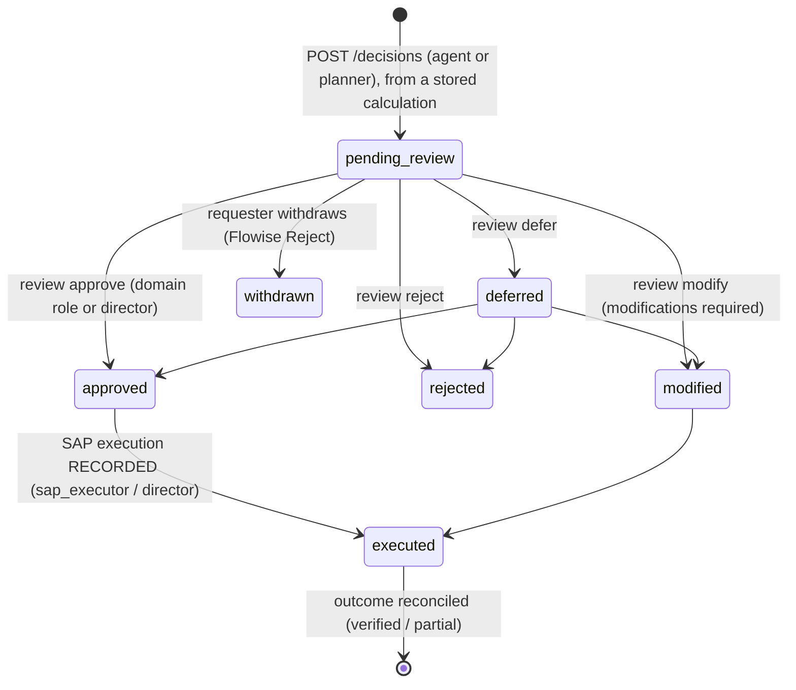

# Human approval

The Flowise Human Input node is a **checkpoint for the requester, not an approval**. The decision exists only when an authorised
human records it in the SCInsight API with their own key. The agent key can never review.



- **Decided once.** A second review gets 409. The status check and the update run in one transaction under an advisory lock.
- **The explanation is mandatory** (at least 3 characters). `modify` also needs `modifications`.
- **Audited.** Every review, withdrawal and execution record is appended to the SHA-256 audit chain, with the reviewer's id and roles.
- **Idempotent.** The same calculation and idempotency key return the existing recommendation (`idempotent_replay: true`).

## In Flowise (supervisor)

1. The specialist returns its analysis and `Decision calculation: CALC-…`.
2. The supervisor checks that calculation through the API and creates the recommendation (`pending_review`).
3. The run **pauses** at Human Input. The message names the recommendation and the roles that may decide it.
4. The manager decides in the API (Swagger `http://localhost:8100/docs` → *Authorize* with their key):
   ```bash
   curl -X POST http://localhost:8100/api/v1/decisions/REC-…/review -H "X-API-Key: $SCI_WAREHOUSE_KEY" \
        -H 'Content-Type: application/json' -d '{"decision":"approve","explanation":"Move the long-dated batch to Madrid."}'
   ```
5. The requester clicks **Proceed**. The flow reads `GET /decisions/{id}` and reports the verified result:
   - approved: "**approved** by u-warehouse-manager (planner, warehouse_manager) …"
   - not reviewed yet: "still **pending_review** … Clicking Proceed in Flowise is not an approval."
6. **Reject** withdraws the recommendation (requester only, pending only).

Resuming through the API:
```json
POST /api/v1/prediction/<supervisor id>
{"question":"proceed","chatId":"<chatId of the paused run>","humanInput":{"type":"proceed","startNodeId":"humanInputAgentflow_0","feedback":"ok"}}
```

## SAP execution

SCInsight never writes to SAP. After approval, an authorised SAP user executes the change in SAP. The `sap_executor` then
records the document number (`POST /decisions/{id}/sap-execution`). A SAP document can be linked to only one recommendation (409).
