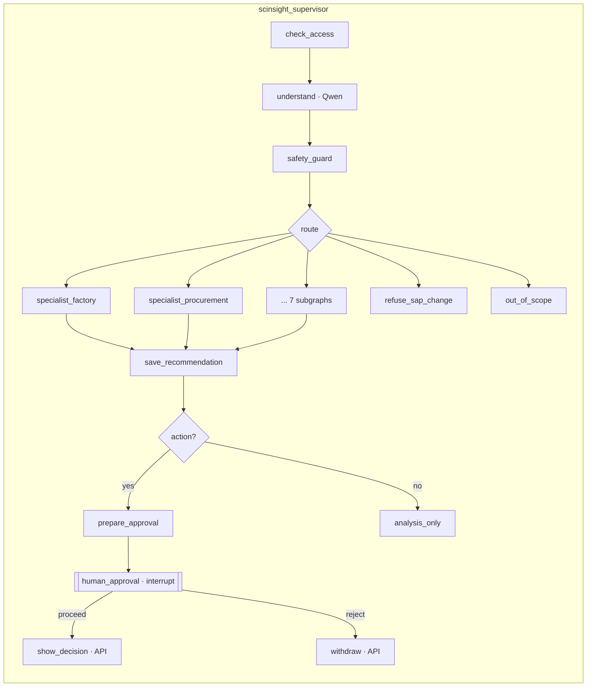

# LangGraph mirror of the SCInsight Flowise flows

The same chat bot, SC Agent Manager and 7 specialists exist twice:
- as Flowise flows (`flowise/`)
- as LangGraph graphs (`backend/scinsight/lg/`)

Both call the same SCInsight API with the same agent key and use the **same prompt files** (`flowise/prompts/*.md`, also shipped in
the Docker image). So a comparison measures the runtime, not two different designs.
Analysis and recommended hybrid: [FLOWISE_VS_LANGGRAPH.md](FLOWISE_VS_LANGGRAPH.md) · raw results: [FLOWISE_VS_LANGGRAPH_RESULTS.md](FLOWISE_VS_LANGGRAPH_RESULTS.md).

## Flow-by-flow mapping

| Flowise | LangGraph graph (Studio name) | File |
|---|---|---|
| `SCInsight-Cosmetics-Chatflow-v1` | `scinsight_chat` | `backend/scinsight/lg/chat.py` |
| `SCInsight-Cosmetics-Supervisor-Agentflow-v1` | `scinsight_supervisor` | `backend/scinsight/lg/supervisor.py` |
| 7 specialist Agentflows | `scinsight_factory_planning`, `scinsight_procurement`, `scinsight_warehouse`, `scinsight_inventory_optimizer`, `scinsight_logistics`, `scinsight_quality`, `scinsight_outcome_learning` | `backend/scinsight/lg/specialists.py` |
| Custom Function JavaScript | Python ports, behaviourally identical | `backend/scinsight/lg/common.py` |

Each specialist is a subgraph with the same steps as its Flowise Agentflow:

`check_access → read_request (Qwen) → calculate (SCInsight API) → policy_search → write_answer (Qwen) → check_numbers`

with `stop_access` and `stop_input` exits. The learning specialist skips the model steps.

## LangGraph features used (and why)

| Feature | Where | Why |
|---|---|---|
| Typed state, `input_schema` / `output_schema` | All graphs | Studio shows only *Messages* as input; outputs are `answer`, `intent`, `rec_id` |
| Conditional edges | Access check, routing, result check, approval choice | The same branches as the Flowise Condition nodes |
| Subgraphs | Supervisor → 7 specialists | Each specialist is runnable alone in Studio and as a step of the supervisor |
| `interrupt()` + `Command(resume=…)` | `human_approval` | Real human-in-the-loop: the run pauses; resume with `proceed` / `reject`; the decision is read from the API |
| Checkpointed threads | LangGraph server | Paused runs survive; conversation memory for `scinsight_chat`; full history in Studio |
| Tool calling + `ToolNode` loop | `scinsight_chat` | The same 2 tools as the Flowise chatflow, max 4 iterations |
| Assistants (configurable) | `supplier_deep_agent`, `scinsight_supervisor` | Presets selectable in Studio (`scripts/langgraph_assistants.py`) |

## Run it

- **Studio:** https://smith.langchain.com/studio/?baseUrl=http://localhost:8123 → pick `scinsight_supervisor`. Inputs are ready to paste in `langgraph/studio/` (see its README).
- **API:**
  1. `POST http://localhost:8123/threads`
  2. `POST /threads/{id}/runs/wait` with `{"assistant_id": "scinsight_supervisor", "input": {"messages": [{"type": "human", "content": "…"}]}}`
  3. To resume: `{"assistant_id": "scinsight_supervisor", "command": {"resume": "proceed"}}`
- **Compare both runtimes:** `python3 scripts/scinsight_compare.py` (the 40 role questions + 3 guards + one approval cycle each).
- **Tests:** `tests/scinsight/test_langgraph_mirror.py` (hermetic: real SCInsight API in-process, scripted model).

## The role questions (one source, three uses)

`data/scinsight/role_questions.json` holds 5 questions for each of 8 roles:
- production planner
- procurement manager
- warehouse manager
- inventory planner
- logistics manager
- quality manager
- AI/MLOps manager
- supply chain director

Each question records the expected specialist and the facts to check.

| Use | How |
|---|---|
| Flowise conversation starters | Each specialist Agentflow shows its role's 5; the SC Agent Manager and the chat bot show the director's 5 (`deploy.py build`) |
| LangGraph Studio inputs | `langgraph/studio/inputs/…/<role>.yaml` |
| Test set | `scripts/scinsight_compare.py` |
