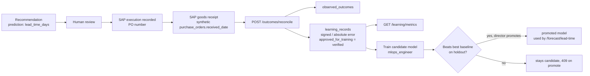

# Outcome learning

**Approval is not proof.** A recommendation teaches the system something only when its real outcome is verified against SAP documents.

## What is predicted
- A purchase request (from material readiness or material replenishment) stores
  `prediction = {metric: lead_time_days, predicted: <lead_days of the chosen supplier>, supplier_id, material_id, basis, po_id?}`.
- The prediction uses the **demonstrated** lead time (mean of goods receipts when there are 3 or more), not the contract figure.

## Reconciliation (`POST /outcomes/reconcile`)
- **Only executed recommendations.** Others get 409; recommendations without a lead-time prediction get `unsupported_metric`.
- The PO comes from `prediction.po_id` or the recorded SAP execution.
- **Actual** = receipt date minus order date of the synthetic SAP PO. Statuses:
  - `verified`: complete receipt
  - `partial`: flagged, not used for training
  - `pending`: no receipt yet
  - `missing`: no PO
- Writes `observed_outcomes` and `learning_records` atomically. It is idempotent: a second call returns `already_reconciled`.

**Demo case.** REC-HIST-0001 predicted 5 days. PO-4500020950 was received after 9 days, so the signed error is **+4** and the
absolute error 4 (80 %). The record is verified and approved for training.

## Metrics (`GET /learning/metrics`, verified outcomes only)
- verified outcome coverage
- supplier lead-time MAE
- demand-forecast WAPE (back-tested against a naive baseline)
- recommendation acceptance, modification and execution rates

Stock-out warning accuracy and business impact show `null` with a reason, because no verified source for them exists yet.
They are never estimated.

## Model governance
- `POST /learning/train-lead-time-model` (mlops_engineer):
  - needs at least 20 receipts; uses a time-ordered 75/25 split
  - trains a GradientBoostingRegressor (150 trees, depth 2, seed 7)
  - compares it against two baselines: the contract lead time and the supplier mean
  - stores a **candidate** in `model_versions`
- `POST /learning/models/{id}/promote` (supply_chain_director only) refuses with 409 unless the candidate beats the best baseline.
  On the synthetic data the model (MAE 2.03 days) does **not** beat the supplier mean (1.19 days), so promotion is refused, correctly.
- `POST /learning/retraining-requests` records a request with its evidence; status `pending_human_approval`.
